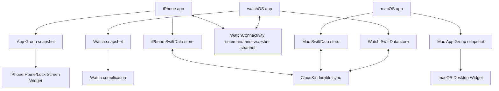

# Architecture

## Data Flow

## Shared Business Core

`Packages/AttendanceKit` is the single source for:

- Monday-Friday workday policy.
- 8-hour target calculation.
- 80% monthly attendance requirement using `ceil`.
- Day-key generation through injected `Calendar` and `TimeZone`.
- Duplicate record conflict resolution by `dayKey`.
- Widget timeline refresh logic.

The package is intentionally Foundation-first. `AttendanceRecord` is a pure domain model because the current CommandLineTools environment cannot compile SwiftData macros in Swift Package tests. App persistence maps SwiftData storage objects to this domain type.

## iPhone App

The main navigation is now:

- Today
- Month
- History
- Settings

The old timesheet/project/break/geofencing code remains in the repository as legacy code and is not destructively migrated.

The attendance screens use a shared visual language derived from the supplied reference: a soft sky/mint/blush background, translucent panels, blue primary metrics, icon-led status summaries, and a stable native tab bar. The Today screen keeps the countdown as the dominant value and maps daily progress to a 30-dot grid without introducing income-specific reference features.

## Shared Attendance App Layer

`Shared/Attendance/AttendanceStore.swift` owns app-level persistence orchestration for the new attendance flow. It maps SwiftData storage to `AttendanceKit`, writes widget snapshots, and avoids direct iOS-only device APIs except behind conditional compilation.

`Shared/Attendance/AttendanceDashboardView.swift` is the reusable SwiftUI entry point for future macOS/watchOS app shells. Platform apps should embed it with `.regular` or `.compact` display style instead of duplicating Today/month formulas outside `AttendanceKit`.

## Persistence

`AttendanceStorageRecord` is the SwiftData storage model for attendance records. It maps to and from `AttendanceKit.AttendanceRecord`.

`SharedModelContainer` now tries:

1. Target capability flags and App Group availability preflight, followed by the App Group SwiftData store.
2. Local SwiftData store fallback.
3. In-memory fallback.

`AttendanceAppGroupEnabled` and `AttendanceCloudKitEnabled` declare which capabilities each target has configured. The iPhone app enables both; the iPhone widget enables App Group only; unsigned or not-yet-configured Mac and Watch builds enable neither. Combined with the App Group URL preflight, this prevents SwiftData from entering non-throwing fatal paths for missing App Group or CloudKit entitlements. The first two failure states are non-fatal and exposed in the UI.

## macOS App

The native `Working Hour Mac` target embeds `AttendanceDashboardView(displayStyle: .regular)` and uses the same `AttendanceStore`, `AttendanceStorageRecord`, snapshot store, model container, and `AttendanceKit` package as iOS. Its schema intentionally includes only the new attendance model, so legacy iOS timesheet, geofencing, and Live Activity models are not pulled into the Mac target.

`Working Hour Mac Widget` is a WidgetKit extension embedded in the Mac app. It shares the existing timeline provider and snapshot-only small/medium widget views, so no attendance formulas or live SwiftData/CloudKit queries are duplicated in the extension.

## Widget Snapshot

The app writes `AttendanceWidgetSnapshot` JSON into the App Group container. The widget reads this snapshot and uses `WidgetTimelineLogic` for meaningful refresh dates. It does not query CloudKit or SwiftData live during timeline generation.

## watchOS App and Complication

The native `Working Hour Watch` target is a modern SwiftUI watchOS application associated with the iPhone bundle through `WKCompanionAppBundleIdentifier`. It embeds `AttendanceDashboardView(displayStyle: .compact)` and reuses the same attendance store, storage model, model container, snapshot store, and `AttendanceKit` rules. Without signed capabilities it uses local SwiftData and shows a compact local-storage status.

`Working Hour Watch Widget` is a WidgetKit extension embedded in the Watch app. It reuses the existing accessory widget provider/view, reads only `AttendanceWidgetSnapshot`, and supports inline, circular, and rectangular accessory families.

## WatchConnectivity

`WatchConnectivityCoordinator` is compiled into the iPhone and Watch apps. The Watch writes locally first, then sends an idempotent `WatchCommand` through `sendMessage` when reachable or `transferUserInfo` when offline. The iPhone persists the latest 256 processed command UUIDs, applies new commands through `AttendanceStore`, and returns a `WatchSyncSnapshot` containing canonical current-month records plus the Widget snapshot. `applicationContext` keeps only the newest snapshot for later delivery.

Transport payloads and their JSON codec live in `AttendanceKit`; neither platform adapter duplicates weekday, target-duration, monthly-progress, or conflict-resolution rules.

## Remaining Target Work

The native macOS and watchOS app targets now build and run. Their WidgetKit extensions build and are embedded, but adding them to the desktop/watch face remains a manual UI check. Mac/Watch App Group and CloudKit signing plus physical-device WatchConnectivity delivery remain pending.
