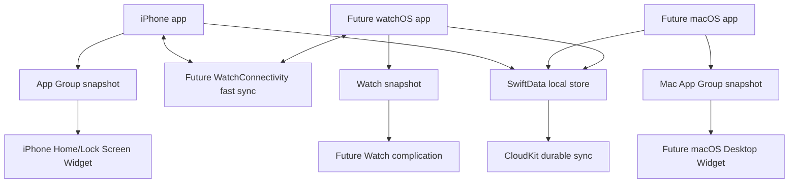

# Architecture

## Data Flow

## Shared Business Core

`Packages/AttendanceKit` is the single source for:

- Monday-Friday workday policy.
- 8-hour target calculation.
- 80% monthly attendance requirement using `ceil`.
- Day-key generation through injected `Calendar` and `TimeZone`.
- Duplicate record conflict resolution by `dayKey`.
- Widget timeline refresh logic.

The package is intentionally Foundation-first. `AttendanceRecord` is a pure domain model because the current CommandLineTools environment cannot compile SwiftData macros in Swift Package tests. App persistence maps SwiftData storage objects to this domain type.

## iPhone App

The main navigation is now:

- Today
- Month
- History
- Settings

The old timesheet/project/break/geofencing code remains in the repository as legacy code and is not destructively migrated.

## Persistence

`AttendanceStorageRecord` is the SwiftData storage model for attendance records. It maps to and from `AttendanceKit.AttendanceRecord`.

`SharedModelContainer` now tries:

1. App Group SwiftData store.
2. Local SwiftData store fallback.
3. In-memory fallback.

The first two failure states are non-fatal and exposed in Settings.

## Widget Snapshot

The app writes `AttendanceWidgetSnapshot` JSON into the App Group container. The widget reads this snapshot and uses `WidgetTimelineLogic` for meaningful refresh dates. It does not query CloudKit or SwiftData live during timeline generation.

## Remaining Target Work

Native macOS and watchOS targets still require a complete Xcode installation to create and verify safely. The current environment cannot run `xcodebuild` or `simctl` because Xcode.app is not installed/selected.
